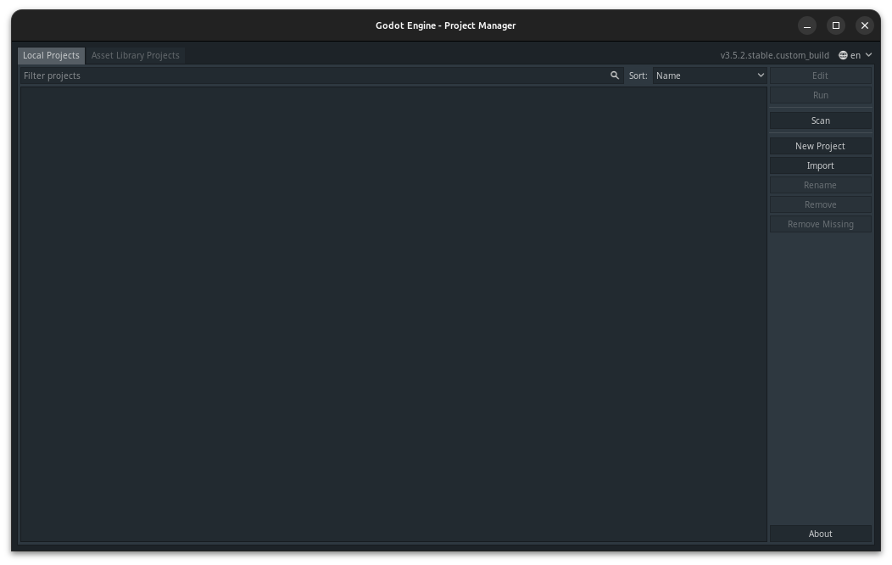

# Zodiac_Board
An foss action rpg for those seeking freedom, knowledge, and furry little friends!

## Instructions
###### How to play the game

1. Download the Godot 3 engine.

2. Download this repo by clicking download in the top right corner or by pulling/cloning the repo via terminal. Unzip it in the directory/folder of your choosing.

3. Run Godot 3.
After running Godot 3, you will see the following:

5. Click Import and navigate to where you unzipped/cloned the project. Click on the file "project.godot".

6. Boom. Game loaded. Now navigate to a scene (.tscn file) within the  project that works (or is on the "fully-operational" list) and click the Clapperboard with the Play symbol on it in the top right corner or press F6 to play the scene.

## Fully-Operational List
This is a list of all of the fully-operational scenes in the project so far. It is updated monthly or whenever there is a new scene that is fully-operational.

- res://Systems/Factories/Chip_Factory/Chip_Factory.tscn
- res://Systems/Factories/Skill_Share/Skill_Share.tscn
- res://Interface/Menu/Skill_Board_Menu/Skill_Board_Menu.tscn
